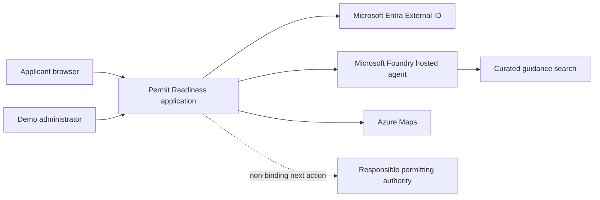
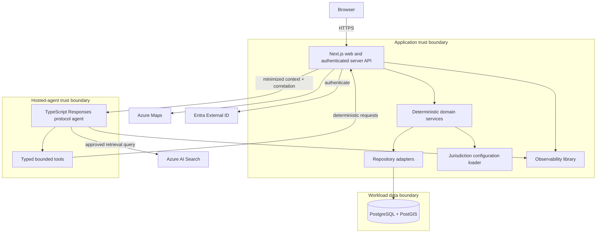

# Architecture authority

## Status and scope

This document defines the target architecture and binding dependency and trust
boundaries for the reference implementation. It is intentionally more concrete
than the current scaffold. Implementation details may evolve through accepted
ADRs, but changes must preserve the product truths in `PRODUCT.md`.

## System context



The system prepares applicants to engage with authorities. Authorities and their
official application systems are outside the system boundary.

## Container view



Only the web application has public ingress. The browser does not call the
database, Foundry, or privileged search endpoints directly. The agent has no
general-purpose database credential.

## Component view

### `apps/web`

- App Router pages and accessible applicant interactions.
- Server-side authentication/session adapter.
- ts-rest HTTP handlers and authorization middleware.
- Project, intake, report, conversation, and task application services.
- Agent gateway that minimizes context, selects explicit versions, applies
  timeouts, validates structured responses, and persists accepted results.
- Adapters for Azure Maps, Entra External ID, and development-only local auth.

### `apps/permit-readiness-agent`

- Foundry Responses protocol `2.0.0` endpoint.
- Conversation orchestration and targeted follow-up behavior.
- Typed tool client using contracts from `packages/contracts`.
- Safe curated-guidance retrieval and citation assembly.
- Structured readiness-report composition and responsible-AI controls.
- No permit-rule ownership, user authorization decisions, or direct persistence.

### Shared packages

- `packages/contracts`: versioned Zod and ts-rest transport, tool, event, error,
  and structured-output contracts.
- `packages/domain`: framework-independent project, intake, missing-information,
  permit-trigger, sequence, and report-acceptance behavior.
- `packages/db`: Drizzle schema/migrations and repository implementations,
  including PostGIS operations and tenant predicates.
- `packages/jurisdiction-config`: validation, loading, and version selection for
  jurisdiction release bundles.
- `packages/guidance-search`: versioned guidance manifests, deterministic
  ingestion, Azure AI Search index contract, and safe retrieval adapters.
- `packages/ui`: accessible, theme-aware presentation primitives; no domain or
  data access.
- `packages/observability`: correlation, privacy-safe telemetry conventions,
  metrics, and tracing helpers.
- `packages/test-utils`: deterministic fixtures and test builders only.
- `infra`: `azd`, Bicep, environment parameters, identities, RBAC, and resource
  wiring; it is not imported by application packages.

## Dependency rules

```text
apps/web ------------------------> contracts, domain, db, config, ui, observability
apps/permit-readiness-agent -----> contracts, observability
db ------------------------------> domain, contracts (only persisted/edge shapes)
jurisdiction-config -------------> contracts, domain (validated input only)
guidance-search -----------------> contracts, Azure SDKs at adapter boundary
domain --------------------------> no app, UI, framework, database, or infra code
ui ------------------------------> no domain, database, agent, or infra code
infra ---------------------------> consumes deployable application contracts only
```

- Cross-process or cross-workspace shapes are authored in `contracts` before
  consumers.
- Handlers call application/domain services, not Drizzle queries directly.
- Domain services depend on repository ports, not persistence implementations.
- Agent tool contracts are narrow use-case contracts, not generic internal APIs.
- Jurisdiction variation cannot add executable code or bypass domain validation.
- Cycles between workspaces are prohibited.
- Infrastructure may configure applications; application code never imports
  infrastructure definitions.

## Domain boundaries

- **Identity and organizations:** authenticated subject mapping, memberships,
  roles, and tenant context.
- **Projects:** project lifecycle, type selection, ownership, and status.
- **Intake:** versioned question sets, answers, completeness, and review.
- **Geography:** point/polygon normalization and deterministic intersection with
  explicitly configured demo zones.
- **Permit catalog:** versioned permit/authorization metadata and authority
  references.
- **Permit reasoning:** deterministic triggers, missing information,
  assumptions, confidence representation, and dependencies.
- **Guidance:** approved source manifests, retrieval metadata, citations, and
  evidence versioning.
- **Readiness reports:** immutable generated snapshots and applicant-visible
  recommendations.
- **Agent conversations:** bounded message/run history and validated structured
  outputs.
- **Tasks and status:** applicant next actions derived from an accepted report.
- **Audit and telemetry:** security/audit events separated from operational
  diagnostics and raw business content.

Domain boundaries communicate through explicit services and contracts. Database
tables are persistence details, not shared domain APIs.

## Tenancy and authorization

An organization is the logical tenant. Users act through explicit organization
memberships; a project, its location, answers, reports, conversations, and tasks
belong to exactly one organization. Every user-scoped service operation carries
an authenticated subject and tenant/project scope.

Authorization is enforced in the web application service layer and reinforced
with database tenant keys, foreign keys, and ownership predicates. Object
identifiers alone never grant access. Background work and agent callbacks carry
scoped, short-lived correlation/run identifiers rather than user authority.

Demo administration is a limited role for selecting approved seed packs and
resetting synthetic data. It does not imply cross-tenant content access.

## Trust boundaries

### Authentication boundary

- Production authentication uses Entra External ID and validates issuer,
  audience, signature, lifetime, and subject mapping server-side.
- The browser holds only the session material required by the selected secure
  web pattern; APIs derive tenant context from the verified session.
- Local demo identity is explicit, development-only, visibly labelled, seeded,
  and impossible to enable accidentally in production.

### Data boundary

- PostgreSQL/PostGIS is reachable only by workload identities/network paths.
- Repository methods require tenant scope for user data.
- Secrets and connection details come from environment references or Key Vault,
  never jurisdiction configuration or source control.
- Raw intake, conversation content, and geometry are treated as potentially
  sensitive. Logs, traces, and evaluations exclude them by default.

### Agent and retrieval boundary

- The web server authorizes the request before invoking the agent and sends the
  minimum normalized project context needed for the run.
- Agent input, retrieved text, tool output, and model output are all untrusted
  and schema-validated at their boundaries.
- Retrieved instructions cannot override system policy or tool authorization.
- Retrieval strips and flags instruction-like passages, propagates the flag to
  tool output, and excludes malformed, unapproved, stale, unreviewed, expired,
  or not-yet-effective evidence.
- The agent can call only allow-listed, typed operations scoped to the current
  project/run. It receives neither a database credential nor arbitrary network,
  filesystem, or code-execution capability.
- The application validates the final structured output and applicable version
  identifiers before persistence. Plain model text never mutates system state.

## Deterministic versus agent responsibility

| Deterministic application/domain responsibility                   | Agent responsibility                                     |
| ----------------------------------------------------------------- | -------------------------------------------------------- |
| Authentication, tenant ownership, and authorization               | Conversational orchestration                             |
| Project normalization and intake completeness calculation         | Ask focused follow-up questions                          |
| Geographic demo-zone intersection                                 | Explain supplied geographic signals                      |
| Permit trigger evaluation and rule version selection              | Explain likely outcomes without strengthening certainty  |
| Missing-information and dependency/sequence calculation           | Organize recommendations into clear applicant language   |
| Configuration and guidance release validation                     | Retrieve from the approved corpus and preserve citations |
| Structured-output validation and persistence                      | Compose a response matching the contracted schema        |
| Idempotency, audit events, and task creation from accepted output | Refuse binding legal or eligibility determinations       |

The agent cannot invent permits, rules, authorities, evidence, confidence, or
completion state. When deterministic results and prose conflict, deterministic
results win and the response is rejected or degraded.

## Primary data flow

1. The applicant signs in; the server establishes subject, organization, and
   role context.
2. The server validates and saves project, geometry, and intake changes through
   tenant-scoped services and repositories.
3. A readiness run snapshots the project input, rule/configuration release, and
   approved guidance release identifiers.
4. Deterministic services calculate known gaps and initial rule results.
5. The server sends a minimized context, deterministic outputs, allowed tool
   scope, and correlation/run identifiers to the hosted agent.
6. The agent may request additional deterministic calculations through typed
   tools and retrieve approved guidance passages.
7. The agent returns a contracted structured report with citations, assumptions,
   missing information, and non-binding language.
8. The server validates authorization, schema, source/rule versions, and
   internal consistency before atomically saving the report and derived tasks.
9. The browser receives an applicant-safe representation. Audit and operational
   telemetry record metadata and outcomes, not raw content by default.

Retries use the same idempotency/run key and must not duplicate reports, tasks,
or audit outcomes.

## Jurisdiction configuration boundary

A configuration release is immutable, schema-versioned, and identified by
jurisdiction and release version. It can select approved metadata, project
types, question sets, permit/rule data, synthetic zones, guidance manifests,
disclaimers, escalation text, feature flags, and references to approved brand
assets. It cannot contain secrets, arbitrary code, database queries, prompts
that override agent policy, or unreviewed remote assets.

Reports retain the exact configuration, rules, and evidence release identifiers
used. Details are in
[`docs/design-docs/jurisdiction-configuration.md`](docs/design-docs/jurisdiction-configuration.md).

## Deployment topology

The target Azure topology is:

- public HTTPS ingress to a Next.js Azure Container App;
- private or restricted workload access to Azure Database for PostgreSQL
  Flexible Server with PostGIS;
- Microsoft Foundry project, model deployment, and separately versioned hosted
  agent container from Azure Container Registry;
- Azure AI Search containing only curated, versioned guidance;
- Azure Maps for map presentation and configured location capture;
- Key Vault for secrets/references not supported directly by managed identity;
- Application Insights and Log Analytics for correlated telemetry; and
- storage for deployment/evaluation artifacts and approved source material when
  required.

Managed identities and least-privilege RBAC are preferred. GitHub Actions uses
OIDC. Full private-network hardening is a production profile; only the web
ingress is public in the reference topology. One root `azure.yaml` and reviewed
Bicep are the deployment authority.

Two environments are defined:

- **dev:** cost-conscious, synthetic data, local/demo integrations where
  explicitly enabled, automatic deployment after main-branch quality gates.
- **prod:** isolated data and identities, stronger sizing/retention/networking,
  immutable candidate versions, protected approval, regression evaluation, and
  recorded rollback targets.

No environment shares databases, search indexes, secrets, identities, or agent
run state. See [`ADR-0004`](docs/decisions/0004-deployment-and-environments.md).

## Observability and audit

- Propagate a correlation ID across browser request, web handler, domain calls,
  persistence, Foundry run, typed tools, and report save.
- Record deployment revision, agent version, model deployment, contract version,
  configuration release, rule release, and guidance release.
- Measure request/report completion, latency, dependency errors, agent/tool
  errors, token usage, validation rejection, retry, and evaluation results.
- Use OpenTelemetry-compatible traces and structured logs.
- Separate immutable security/business audit events from mutable operational
  logs.
- Do not log raw tokens, secrets, complete prompts, intake answers,
  conversations, retrieved passages, report bodies, or precise geometry by
  default. Approved diagnostic capture must be time-bound and access-controlled.
- Health indicates process liveness; readiness confirms required dependencies
  and configuration are usable without exposing sensitive detail.

## Failure behavior

- **Identity unavailable:** deny new authenticated operations safely; never fall
  back to local demo identity.
- **Database unavailable:** reject writes, avoid partial state, and present a
  retryable service error.
- **Maps unavailable:** preserve form work and provide a non-map location
  alternative; do not fabricate spatial signals.
- **Agent/model unavailable, slow, or over quota:** retain project/intake data,
  show deterministic gaps/results where safe, mark the report incomplete, and
  allow retry. Do not save prose as a completed report.
- **Search unavailable or no approved evidence found:** disclose that grounded
  guidance is unavailable; omit unsupported claims and citations.
- **Malformed or policy-violating model/tool output:** reject it at the contract
  boundary, record a safe diagnostic, and return a controlled degraded result.
- **Configuration invalid:** fail deployment/startup or release activation; do
  not silently use a different jurisdiction release.
- **Persistence after agent success fails:** retry with the same idempotency
  key; the user sees no completed report until the transaction commits.

Retries are bounded with timeouts and jitter where safe. Authorization,
validation, and deterministic business failures are not retried as transient
errors. Runbooks and numeric objectives will be added with implementation
evidence.

## Security and privacy

- Apply least privilege, managed identity, secure defaults, dependency
  validation, encryption in transit, and platform encryption at rest.
- Threat-model tenant isolation, IDOR, session/token theft, prompt injection,
  indirect retrieval injection, tool abuse, data exfiltration, unsafe output,
  dependency compromise, and administrative misconfiguration.
- Minimize collection and agent context; define retention/deletion behavior
  before production use.
- Validate file/content type, size, geometry, identifiers, enums, and text at
  ingress and at every untrusted boundary.
- Escape or safely render model/retrieval content; never execute generated HTML,
  script, SQL, shell, or code.
- Preserve source and decision provenance without placing sensitive business
  content in telemetry.
- Complete jurisdiction-specific privacy, records-management, security, legal,
  and responsible-AI review before production adoption.

## Key quality attributes

1. **Safety and correctness:** deterministic rules are authoritative;
   unsupported conclusions fail closed.
2. **Security and privacy:** strong tenant isolation and least-data handling.
3. **Accessibility:** WCAG 2.2 AA target across complete journeys and degraded
   states.
4. **Traceability:** reports identify the input, rule, configuration, agent, and
   evidence versions used.
5. **Reliability:** atomic persistence, idempotent retries, bounded
   dependencies, and useful degradation.
6. **Configurability:** jurisdictions vary through validated data/content, not
   forks or executable extensions.
7. **Maintainability:** contract-first boundaries, acyclic workspaces, and
   framework-independent domain logic.
8. **Operability:** correlated, privacy-safe telemetry and version-aware
   rollback.
9. **Performance:** interactive project/intake actions do not depend on model
   latency; agent work is streamed or asynchronous within explicit timeouts.
10. **Portability:** cloud and agent integrations sit behind owned application
    boundaries even when the reference deployment uses Azure services.

## Accepted decisions

- [`ADR-0001: Contract-first architecture`](docs/decisions/0001-contract-first-architecture.md)
- [`ADR-0002: Hosted-agent boundary`](docs/decisions/0002-hosted-agent-boundary.md)
- [`ADR-0003: Identity approach`](docs/decisions/0003-identity-approach.md)
- [`ADR-0004: Deployment and environment strategy`](docs/decisions/0004-deployment-and-environments.md)
