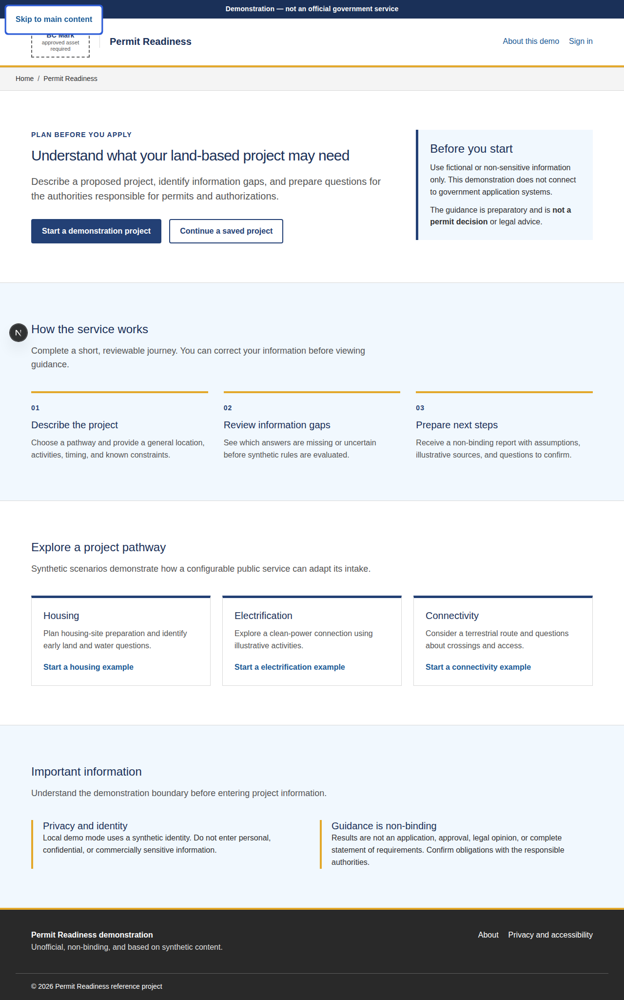
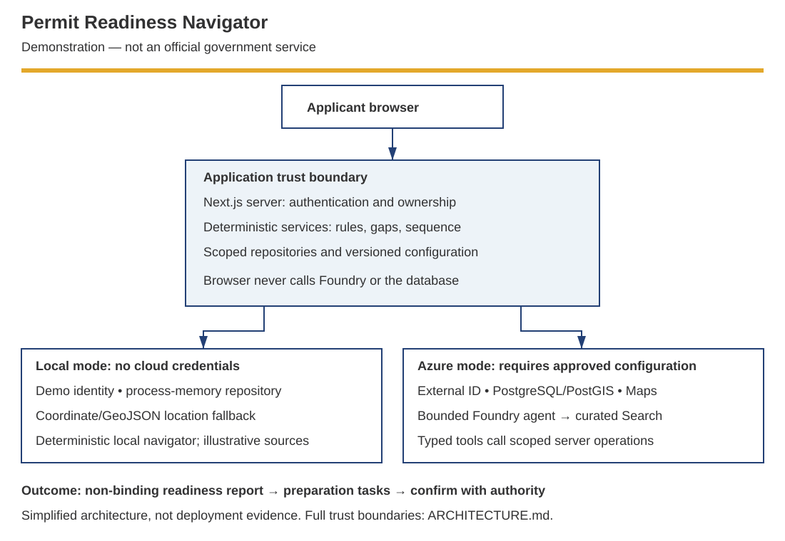

```text
                         /\                 /\
                  /\    /  \      /\       /  \
                 /  \__/    \____/  \_____/    \
                /________________________________\
                       LAND + PROJECT CONTEXT
                                  |
                                  v
                  +-------------------------------+
                  |  PERMIT READINESS NAVIGATOR    |
                  |  Rules decide. AI explains.    |
                  +-------------------------------+
                                  |
                                  v
                       [ REPORT ] ---> [ NEXT STEP ]
```

# Permit Readiness Navigator

Help applicants understand what to prepare before contacting permitting
authorities—not just receive another chatbot answer.

**Demonstration only. Not an official government service, legal opinion, permit
application, or approval.**

## Customer story

Applicants planning land-based projects often struggle to identify the right
authorities, information, and next steps. Guidance is spread across sources and
uses terminology that early-stage applicants may not know. This can cause
incomplete enquiries and repeated clarification for applicants and service
teams. This reference combines structured intake, location context,
deterministic rules, and bounded AI assistance to produce a reviewable
preparation report and tasks.

The B.C.-inspired example uses original synthetic content and does not imply
Government of British Columbia endorsement. The value hypothesis is
**better-prepared enquiries and fewer clarification cycles**, not faster
approvals.

## See the journey



1. Create a fictional connectivity project.
2. Answer structured questions, keeping uncertain answers **Unknown**.
3. Confirm an illustrative location using the non-map fallback.
4. Review and correct the project summary.
5. Ask the navigator for preparation help.
6. Generate a report with possible requirements, gaps, sources, and provenance.
7. Open the derived tasks and complete a preparation action.

Use the [5-/15-minute demonstration scripts](docs/runbooks/customer-demo.md),
[captioned local recording](docs/assets/walkthrough.html), and
[asset/evidence inventory](docs/runbooks/customer-demo.md#evidence-and-assets).
The recording is a short automated walkthrough, not a narrated five-minute demo.

## Choose your experience

|                   | Local demonstration                      | Azure deployment                          |
| ----------------- | ---------------------------------------- | ----------------------------------------- |
| Purpose           | Learn and rehearse the applicant journey | Exercise configured cloud integrations    |
| Identity          | Explicit demo identity                   | Reviewed environment-specific identity    |
| Persistence       | Process memory; not durable              | PostgreSQL/PostGIS                        |
| Navigator         | Deterministic local adapter              | Configured Foundry-hosted agent           |
| Location          | Coordinate/GeoJSON fallback              | Configured Maps integration with fallback |
| Cloud credentials | Not required                             | Required                                  |
| Cost              | No Azure resource provisioning           | Azure resource and model usage charges    |

Local operation does not prove that Foundry, Search, Maps, External ID, or cloud
persistence is deployed or working.

## Prerequisites

- Node.js 22 (the CI baseline) and Corepack.
- The repository pins pnpm through `packageManager`; use it through Corepack.
- Only database workflows additionally need PostgreSQL 16 with PostGIS 3.x.

## Quick start

```sh
corepack enable
corepack pnpm install --frozen-lockfile
corepack pnpm --filter @permit-readiness/web dev
```

Open http://localhost:3000 and select **Start a demonstration project**, then
**Continue as demo applicant**. Use only fictional project information.

The minimum local journey needs no database, map key, Azure credentials, or
Foundry deployment. **Do not copy `.env.example` for this path**: its
`DATABASE_URL` selects the database adapter. Start without inherited
`DATABASE_URL`, remote agent, or deployed authentication settings; see
[setup and reset](docs/runbooks/customer-demo.md#local-setup-and-reset).

Expected result: a report with explicit information gaps, illustrative sources,
limitations, and preparation tasks. Local records disappear when the server
process restarts; signing out is not a data reset.

## Architecture and safety



The browser communicates with the web server, never directly with Foundry or the
database. Deterministic services own permit-trigger results; the navigator
explains them and cannot issue regulatory decisions. See
[ARCHITECTURE.md](ARCHITECTURE.md) for the authoritative diagrams, ownership
constraints, provenance, and failure behavior.

## Validate changes

```sh
corepack pnpm validate
corepack pnpm --filter @permit-readiness/agent eval:preflight
corepack pnpm --filter @permit-readiness/web exec playwright install --with-deps chromium
corepack pnpm --filter @permit-readiness/web test:e2e
```

Local evaluation preflight validates checked-in assets, not a remote Foundry
run. Browser smoke checks do not constitute a WCAG certification or a
penetration test.

## Deploy to Azure

Start with the
[deployment decision guide](docs/runbooks/azure-infrastructure.md#choose-a-deployment-path).
Deployment requires reviewed identity, networking, database, model quota,
runner, and environment configuration. Obtain cost approval before provisioning
or cloud evaluation. The runbook covers initialization, protected promotion,
rollback, and teardown; this is not an unconditional one-command deployment.

## Adapt for another jurisdiction

Follow the [adaptation guide](docs/design-docs/adapting-the-reference.md).
Replace reviewed project types, questions, deterministic rules, authorities,
guidance, and approved branding through immutable configuration releases.
Preserve authorization, accessibility, evidence provenance, and non-binding
language. Configuration alone does not establish legal or production readiness.

## Canonical commands

| Command               | Purpose                                                         |
| --------------------- | --------------------------------------------------------------- |
| `pnpm dev`            | Run development tasks for every workspace                       |
| `pnpm build`          | Compile every workspace to its ignored `dist` directory         |
| `pnpm db:check`       | Validate Drizzle migration history                              |
| `pnpm db:migrate`     | Apply PostgreSQL/PostGIS migrations                             |
| `pnpm db:verify`      | Verify that PostGIS is available after migration                |
| `pnpm db:initialize`  | Initialize required versioned reference data                    |
| `pnpm db:seed:demo`   | Explicitly initialize optional synthetic demo rows              |
| `pnpm lint`           | Check workspace manifests, boundaries, and repository structure |
| `pnpm typecheck`      | Type-check every workspace without emitting files               |
| `pnpm test`           | Run workspace, boundary, infrastructure, and workflow tests     |
| `pnpm format`         | Format supported repository files with Prettier                 |
| `pnpm format:check`   | Verify formatting without changing files                        |
| `pnpm infra:validate` | Validate the azd/Bicep contract without contacting Azure        |
| `pnpm validate`       | Run format, lint, typecheck, test, and build checks             |

`pnpm --filter @permit-readiness/web dev` starts the local applicant experience.
The shared library workspaces have no long-running development process; their
`dev` tasks report that boundary and exit.

## Repository map

- `apps/web` — Next.js applicant experience and server boundary
- `apps/permit-readiness-agent` — Foundry Responses protocol service
- `packages/contracts` — shared transport and tool contracts
- `packages/db` — persistence adapters and migrations
- `packages/domain` — deterministic business rules and domain services
- `packages/jurisdiction-config` — versioned jurisdiction configuration
- `packages/observability` — shared telemetry conventions
- `packages/test-utils` — shared deterministic test fixtures
- `packages/ui` — shared accessible presentation primitives
- `infra` — unified `azd`, Bicep, identity, RBAC, and environment graph
- `docs` — product, design, decision, operations, and reference documentation

Start with [AGENTS.md](AGENTS.md) for contribution routing. Durable product,
design, and system boundaries live in [PRODUCT.md](PRODUCT.md),
[DESIGN.md](DESIGN.md), and [ARCHITECTURE.md](ARCHITECTURE.md). The detailed
documentation index is in [docs/README.md](docs/README.md).

For delivery teams, use the
[customer demonstration walkthrough](docs/runbooks/customer-demo.md) and the
[adaptation guide](docs/design-docs/adapting-the-reference.md).

## Limitations and troubleshooting

- No real permit submission, payment, approval, or case tracking.
- No authoritative parcel, title, survey, environmental, or legal analysis.
- Sample rules, authorities, geography, and guidance are illustrative.
- No approved BC Mark is bundled; preserve the explicit placeholder.
- Production use requires legal, privacy, accessibility, security,
  records-management, content, brand, and operational review.
- Map unavailable: use coordinates or GeoJSON.
- Guidance unavailable: disclose the limitation and contact the authority.
- Cloud unavailable: use a separate local demo; never enable fallback identity
  on a deployed production service.
- Setup or form errors: use the
  [walkthrough and recovery guide](docs/runbooks/customer-demo.md).

## Customer engagement

Bring one project type, its intake questions, approved guidance, and a service
owner. Use the
[discovery and pilot brief](docs/runbooks/customer-demo.md#customer-engagement)
to agree a bounded pilot measuring preparation quality and clarification effort.

## Readiness, support, and licensing

This is a **demo-ready candidate**, not a claim of catalog acceptance or
production readiness. [accelerator.yaml](accelerator.yaml) is a schema-neutral
draft; unresolved publication gates are tracked in the
[readiness checklist](docs/runbooks/customer-demo.md#publication-checklist).

For non-sensitive questions, use this repository's
[GitHub Issues](https://github.com/The-weyland-yutani-corporation/bc-gov-land-permit-app/issues).
There is no committed support SLA or approved maintainer assignment. Follow the
[security-reporting guidance](docs/SECURITY.md#reporting-a-vulnerability) before
sharing a possible vulnerability; never put credentials or applicant data in
public issues.

No repository license has been approved or added by this change. Public
visibility is not permission to redistribute or deploy the code. Obtain a
rights-holder approved license and review third-party content/asset notices
before reuse.
